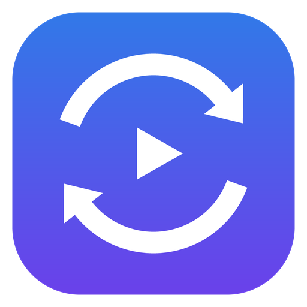
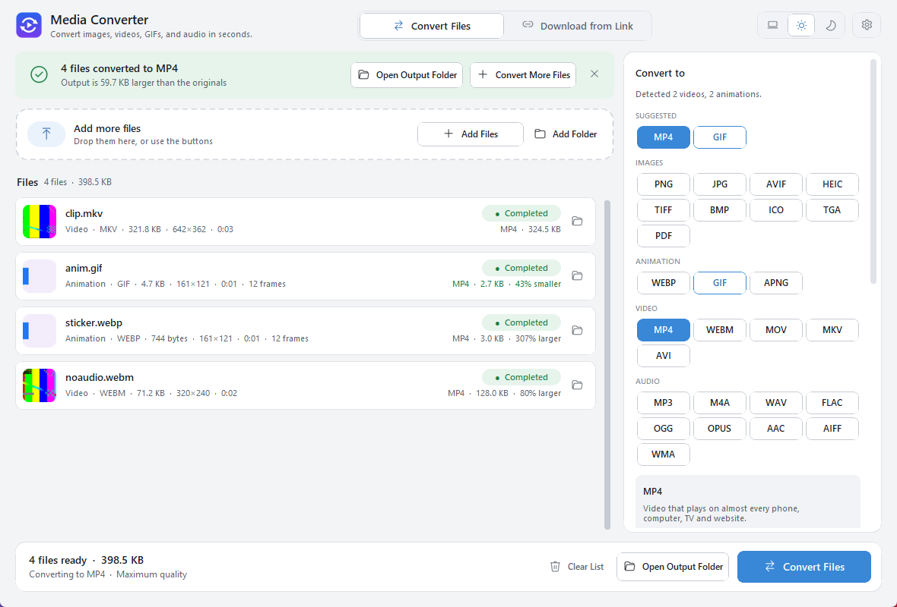

<p align="center"></p>

<h1 align="center">Media Converter</h1>

<p align="center">Convert images, GIFs, videos and audio on Windows and Mac, and save videos and music from YouTube, TikTok, Spotify and other sites.<br>
Free, open source and private: everything runs on your own computer.</p>

<p align="center">
  <a href="https://github.com/anglerequip/media-converter/releases/latest/download/MediaConverter-Setup.exe">
    <picture>
      <source media="(prefers-color-scheme: dark)" srcset="docs/download-dark.svg">
      
    </picture>
  </a>
<!-- MAC-HIDDEN until release 3.3.0 publishes the Mac files
  &nbsp;
  <a href="https://github.com/anglerequip/media-converter/releases/latest/download/MediaConverter-mac-apple-silicon.dmg">
    <picture>
      <source media="(prefers-color-scheme: dark)" srcset="docs/download-mac-dark.svg">
      
    </picture>
  </a>
MAC-HIDDEN -->
</p>
<p align="center"><sub>Windows 10 and 11: <code>MediaConverter-Setup.exe</code>, about 95 MB &nbsp;·&nbsp; a Mac version is coming in the next release
<br>All files, the portable Windows version and release notes: <a href="https://github.com/anglerequip/media-converter/releases/latest">GitHub Releases</a></sub></p>

<p align="center"></p>

## Features

- **All the usual formats:** PNG, JPG, WebP, HEIC, AVIF, GIF, TIFF, ICO, PDF · MP4, MOV, MKV, WebM, AVI · MP3, WAV, FLAC, M4A, OGG, Opus
- **Animations done right:** WebP ↔ GIF ↔ MP4 with exact frame timing and transparency
- **Video links to MP4 or MP3:** YouTube, TikTok, Instagram, X, Reddit, Vimeo and over a thousand more sites
- **Spotify songs, albums and playlists** saved as tagged MP3 or M4A with cover art (see the notes below)
- **Maximum quality by default**, with simple Smaller / Balanced / High / Maximum choices
- **No needless re-encoding:** MKV → MP4 and similar changes are instant and lossless
- **Batches:** drag in files or whole folders and see progress and space saved
- **Works offline:** files are converted on your PC and never uploaded; the app never updates itself or connects in the background, and goes online only when you download from a link
- **Light and dark mode** and smooth animations

## Install

**Windows**

1. Click **Download for Windows** above and run `MediaConverter-Setup.exe`.
2. If Windows shows *"Windows protected your PC"*, click **More info → Run anyway**. This appears because the app isn't signed with a paid certificate.
3. Open **Media Converter** from the Start menu or the Desktop.

<!-- MAC-HIDDEN until release 3.3.0
**Mac**

1. Click **Download for Mac** above. Not sure which Mac you have? Apple menu → **About This Mac**: "Chip: Apple M…" means Apple silicon, "Processor: Intel" means Intel.
2. Open the downloaded `.dmg` and drag **Media Converter** into **Applications**.
3. The first time you open it, macOS says it can't check the developer, because the app isn't registered with Apple (that costs $99 a year). Open **System Settings → Privacy & Security**, scroll down and click **Open Anyway** next to Media Converter. On macOS 14 and older you can instead right-click the app and choose **Open**. After that it opens normally.
MAC-HIDDEN -->

The app never updates itself. For a newer version, download it again from this page; installing over the old one keeps your settings.

## How to use

Drop files in, pick a format and press **Convert Files**. To save a video, paste its link under **Download from Link**. Only download videos you have the right to save.

<details>
<summary><b>Quality settings in detail</b></summary>

| Level | Images | Video | Audio |
|---|---|---|---|
| **Maximum** (default) | JPG 100 (4:4:4), lossless WebP, AVIF/HEIC 100 | H.264 CRF 14 / H.265 CRF 16 / AV1 CRF 20 | MP3 320k, AAC 320k, Opus 256k |
| High | JPG 95, WebP 95 | CRF 18 / 21 / 27 | MP3 V0, AAC 256k |
| Balanced | JPG 88, WebP 85 | CRF 23 / 26 / 34 | MP3 V2, AAC 192k |
| Smaller | JPG 75, WebP 75 | CRF 28 / 30 / 42 | MP3 V5, AAC 128k |
| Lossless (Advanced) | PNG/TIFF/WebP lossless | x264 / x265 / AV1 lossless | ALAC / FLAC |

- Size and frame rate are kept unless you set a maximum; files are never enlarged.
- GIFs use a two-pass palette; at Maximum every frame gets its own 256 colours.
- Photos keep their colour profile and EXIF data and are turned upright.
- 10-bit video stays 10-bit with H.265 and AV1. Album art is kept for MP3, M4A and FLAC.
- Every finished file is opened and checked before it is marked Completed.

</details>

<details>
<summary><b>All supported formats</b></summary>

| You have | You can make |
|---|---|
| **Images:** PNG, JPG, WebP, HEIC, AVIF, TIFF, BMP, ICO, TGA, PSD, JP2, QOI… | PNG, JPG, WebP, AVIF, HEIC, TIFF, BMP, GIF, ICO, TGA, PDF |
| **Animations:** GIF, animated WebP, APNG | MP4, WebM, MOV, MKV, AVI, GIF, WebP, APNG, or the first frame as an image |
| **Video:** MP4, MOV, MKV, WebM, AVI, FLV, WMV, MPG, 3GP, TS, M2TS… | MP4, MKV, MOV, WebM, AVI, GIF, WebP, APNG, and any audio format below |
| **Audio:** MP3, WAV, FLAC, AAC, M4A, OGG, Opus, WMA, AIFF, ALAC… | MP3, M4A, WAV, FLAC, OGG, Opus, AAC, AIFF, WMA |
| **A link** from YouTube, TikTok, Instagram, X, Reddit, Facebook, Vimeo, Twitch, SoundCloud… | MP4 (best quality or H.264), MP3 320 kbps, M4A |

</details>

<details>
<summary><b>Downloads: notes and limits</b></summary>

- **Best video** picks the highest resolution offered; on YouTube that is often AV1 or VP9, which Windows 11 plays. Choose **Compatible video** (H.264) for older devices.
- Private, age-restricted, members-only and copy-protected videos are not supported.
- **Spotify:** Spotify's own audio is copy-protected and is never touched. The app reads each song's title, artist, length and cover from Spotify and looks for the same recording on YouTube Music. Each match is shown with its thumbnail, title and a link so you can check it, and nothing is downloaded until you confirm. The saved file gets Spotify's details. A song is only saved when length, artist and title all match; otherwise it is skipped rather than guessed. M4A keeps YouTube's audio as it is (about 128 kbps AAC); MP3 converts it for older devices. Playlists are limited to their first 100 songs, and podcasts can't be saved because Spotify protects them.
- If a site stops working, download the newest Media Converter from this page: each release ships with the newest yt-dlp.

</details>

<details>
<summary><b>For developers: run from source, build, command line</b></summary>

Run from source (Python 3.10+):

```powershell
git clone https://github.com/anglerequip/media-converter.git
cd media-converter
powershell -ExecutionPolicy Bypass -File install.ps1
```

Build the installer and portable zip exactly like the release (needs only Python 3.12; FFmpeg and Inno Setup are downloaded from pinned addresses and checked by SHA-256, Python libraries come from the hash-locked `build/requirements-lock.txt`):

```powershell
powershell -ExecutionPolicy Bypass -File build\build.ps1
```

Releases are built by [GitHub Actions](.github/workflows/release.yml) from the tagged commit. [SECURITY.md](SECURITY.md) explains how to verify a download.

Command line and tests:

```powershell
python -m converter convert clip.webp --to mp4 --quality max
python -m converter download "https://www.youtube.com/watch?v=..." --mode best
python tests/smoke_test.py
```

Code layout: `converter/` holds the engine (Pillow for images, FFmpeg for everything with a timeline), the yt-dlp downloader and the Spotify matcher; `ui/` holds the interface (CustomTkinter) with its design tokens, components and animations.

</details>

## License

MIT. The bundled components keep their own licences; see [THIRD-PARTY-NOTICES.md](THIRD-PARTY-NOTICES.md). Privacy, network use and how to verify a download: [SECURITY.md](SECURITY.md).
